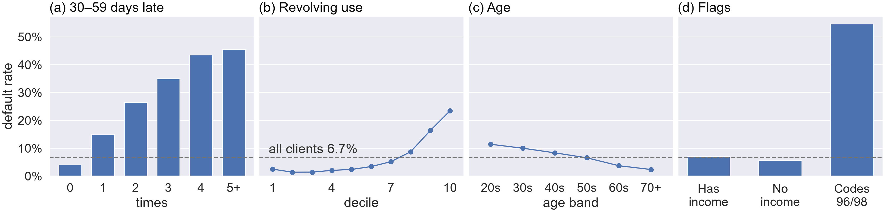
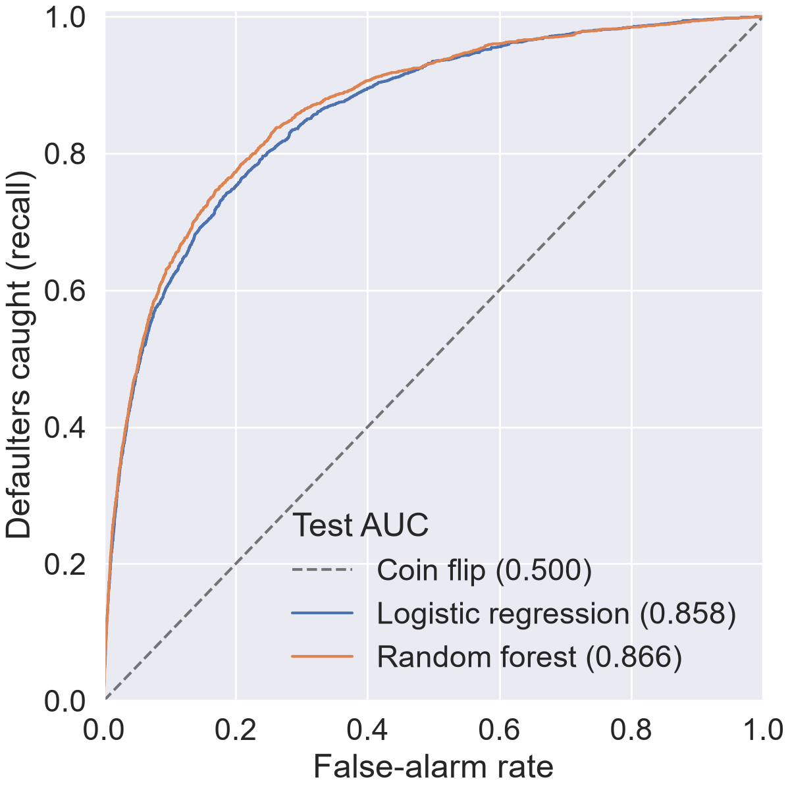
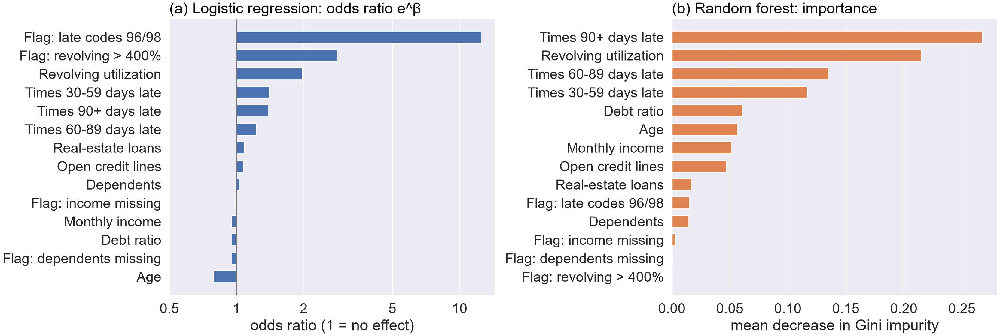

<div align="center">

# [Good and Bad Payers](docs/apresentacao/slides.pdf)

**Predicting serious credit delinquency · Logistic regression vs. random forest**

Machine Learning final project (MCZA002-17) · UFABC · 2026<br>
By [Leonardo Dias Trindade da Silva](https://github.com/LeoDiasTrindade)


[](https://www.kaggle.com/c/GiveMeSomeCredit)<br>
[](https://colab.research.google.com/github/LeoDiasTrindade/good-and-bad-payers/blob/master/notebooks/01_eda.ipynb)

</div>

---

## The competition

[**Give Me Some Credit**](https://www.kaggle.com/c/GiveMeSomeCredit) is a 2011 Kaggle competition with a plain goal: *predict the probability that somebody will experience financial distress in the next two years*.

- **Data:** 150,000 past borrowers with a known outcome, plus 101,503 to score.
- **10 features:** past late payments, use of revolving credit, debt ratio, income, age, dependents, open credit lines and real-estate loans.
- **Target:** serious delinquency, that is, 90 or more days past due within two years.
- **Metric:** AUC, the area under the ROC curve.

Only **6.7%** of the borrowers defaulted, about 7 in every 100. That is why accuracy misleads: calling everyone a good payer is already 93.3% accurate. Here the models are judged by AUC (how well they rank risk) and log-loss (how good their probabilities are).

> **The question:** can we rank applicants by their risk, and how much ranking power does an explainable model give up?

## Late payments raise default risk over tenfold



The default rate goes from **4%** for clients who were never late to **44%** for those late four or more times. Heavy use of revolving credit raises the risk too, and older clients default less. The last panel shows two flags created in the analysis: clients who do not report their income default slightly *less*, and clients with codes 96 or 98 default more than half the time.

## Six data traps, each fixed before modelling

| | Trap | What I found | What I did |
|:-:|---|---|---|
| 01 | Impossible values | Age 0; revolving use up to 50,708× the credit limit | Set to missing; a flag for revolving above 400% |
| 02 | Codes posing as counts | Late counts jump from ≤ 17 to 96 and 98, with 55% default | Set to missing; one flag for the codes |
| 03 | A ratio without its denominator | Income missing for 20% of clients, whose median debt ratio is 1,159 | Debt ratio set to missing when income is |
| 04 | Missing values that inform | No income: 5.6% default against 6.9% | Flags, instead of imputing the signal away |
| 05 | Long tails | Skewness of 127 (income) and 81 (debt ratio) | log(1 + x) for the logistic regression |
| 06 | A leak in my own EDA | Medians imputed using all rows, test rows included | Every step that learns moved inside the pipeline |

## Two models, one leak-free protocol

- **Logistic regression** (main model): every coefficient is an odds ratio, so a refusal can be explained to the client.
- **Random forest** (comparison): 300 trees that find non-linear effects and interactions on their own, but are hard to explain.

Both follow the same path: a stratified 80/20 split with the test set locked away, stratified 5-fold cross-validation for every choice, selection by log-loss, and the test set opened **only once**, at the end.

## The explainable model gives up only 0.008 AUC



On 30,000 clients never used for any choice, with a cut-off that catches 70% of defaulters:

| | Logistic regression | Random forest |
|---|--:|--:|
| AUC (test) | 0.858 | 0.866 |
| Gini (2·AUC − 1) | 0.72 | 0.73 |
| Applicants approved | 80.0% | 82.1% |
| Bad rate of approved | 2.4% | 2.4% |
| Good payers refused | 4,590 | 3,949 |

Approving four in five applicants cuts the bad rate from **6.7%** to **2.4%**. At the same bad rate, the forest approves **649 more customers**.

<br clear="right">

## What drives the risk



Both models agree: **past late payments and revolving use** dominate. In the logistic regression, the flag for codes 96/98 multiplies the odds of default by **12.6**, so the cleaning work paid off. Age lowers the risk, which raises the question from Lecture 9: should a credit model learn this?

## What I would do differently

- **Write the cleaning rules as code from day one.** My EDA imputed using all rows; a shared module fixed that.
- **Set the cut-off from real costs:** the loss on a default against the margin on a good customer.
- **Try gradient boosting and check the calibration** of the probabilities.
- **Discuss whether age belongs** in a credit model at all.

---

## Talk and paper

- **Lightning-talk slides:** [PDF](docs/apresentacao/slides.pdf) or [HTML to present](docs/apresentacao/slides.html) (arrow keys to move, **N** shows the notes, **F** for full screen).
- **Talk script (5 min):** [roteiro.md](docs/apresentacao/roteiro.md).
- **Paper:** [Good and Bad Payers: Logistic Regression versus Random Forest for Predicting Serious Credit Delinquency](docs/paper/main.pdf).

<details>
<summary><b>How to reproduce</b></summary>
<br>

With [uv](https://pypi.org/project/uv/) installed:

```sh
uv sync          # create the environment
make download    # download the Kaggle data (asks for your API token)
make eda         # re-run the exploratory analysis
make modelo      # re-run the modelling (~5 min, mostly the random forest)
make relatorio   # build the paper and the slides
```

To submit to Kaggle, save your token to `~/.kaggle/kaggle.json` (kaggle.com → Settings → API → Create New Token):

```sh
make submit MSG="Random forest"   # submits submissions/submission_rf.csv
make submissoes                   # lists the submissions and their scores
```

</details>

> [!IMPORTANT]
> On the use of GenAI. I see it as an essential tool for productivity and even for personal study, but the purpose of this repository is to work on my modelling skills, facing each difficulty and learning from it. That is why I stress that the exploratory analysis (`01_eda.ipynb`, up to September 2026) was written by me, without GenAI. In the final stretch of the course project (November 2026), I used Sol for the paper template and Claude Opus 5.5 to review the EDA notebook, write the modelling notebook and the preprocessing module, draft the paper and the slides, and translate this README and the notes of the EDA notebook from Portuguese into English, as declared in the *Declaration of AI use* section of the paper.
